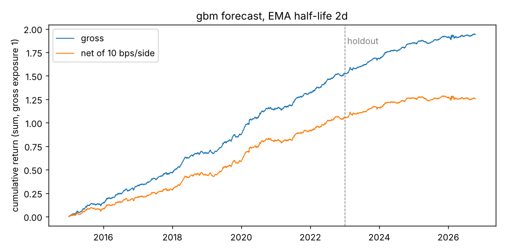
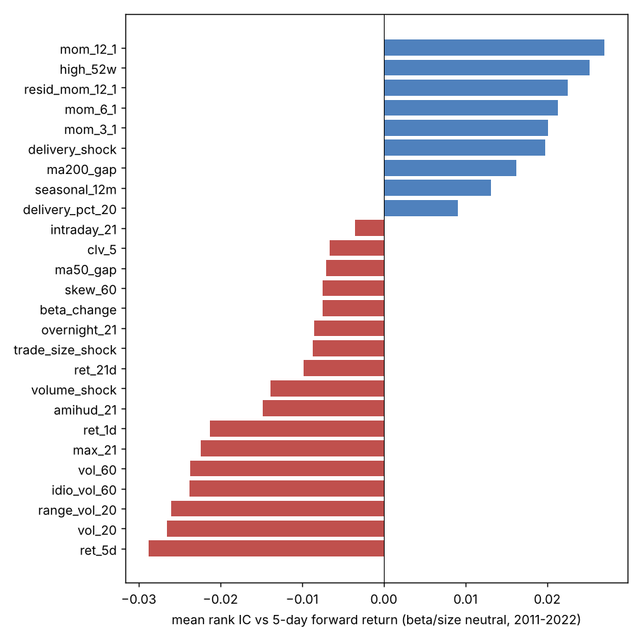
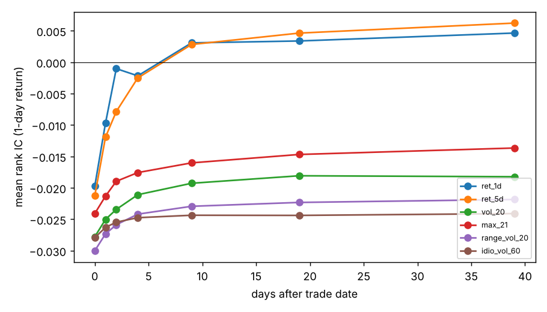

# NSE Alpha Research

A cross-sectional equity research pipeline on Indian stocks (NSE, 2010 to 2026). It builds 28 daily signals, tests each one for predictive power, combines them with walk-forward machine learning, and trades the forecast as a beta- and size-neutral long/short book after transaction costs. The last 3.8 years were held out and only evaluated once, after every modelling choice was fixed.

## Results

Universe: the 500 most liquid NSE stocks each month (1,412 names over the period). Forecast horizon: 5 trading days. Signals are computed at the close of day *t* and traded at the close of *t+1*.

| | Validation (2015–2022) | Holdout (2023 – Oct 2026) |
|---|---|---|
| Net Sharpe, 10 bps per side | **2.90** | **1.16** |
| Gross Sharpe | 4.19 | 2.41 |
| Annual return (net, gross exposure 1) | 13.4% | 5.4% |
| Max drawdown | −5.1% | −4.8% |
| Daily turnover | 24% | 23% |

- **Model selection:** 15 configurations were tried on the validation period (IC-weighted average, ridge at three penalties, gradient boosting; each with three forecast-smoothing half-lives). Gradient boosting won. Its deflated Sharpe probability, which corrects for having tried 15 configurations, is above 0.99.
- **Out of sample the edge roughly halved and then faded.** The yearly net Sharpe was 2.6 in 2023 and 2.7 in 2024, then 0.2 in 2025 and −0.3 in 2026 so far.
- **Costs decide it.** On the holdout, net Sharpe is 1.79 at 5 bps per side, 1.16 at 10 bps and −0.09 at 20 bps, so break-even is about 19 bps.
- **The edge sits in mid-caps.** Restricting to the 200 largest stocks, roughly the single-stock futures list where shorting is practical, the best model's net Sharpe drops to 0.95 in validation and 0.56 in the holdout.



### Which signals carry information

Mean rank IC against 5-day forward returns after neutralising beta and size, 2011–2022 (Newey–West t-statistics, lag 5):

| Signal | Mean IC | t-stat | Reading |
|---|---|---|---|
| 1-day return | −0.021 | −13.4 | short-term reversal, strongest and most consistent |
| 5-day return | −0.029 | −10.9 | reversal |
| 20-day volatility | −0.027 | −10.1 | low-volatility anomaly |
| max daily return, 21d | −0.022 | −9.4 | lottery-stock effect |
| 12-1 month momentum | +0.027 | +6.4 | medium-term momentum |
| 52-week-high proximity | +0.025 | +5.7 | anchoring |
| delivery-percentage shock | +0.020 | +4.4 | NSE-specific: a jump in the share of traded volume taken for delivery predicts gains (data from Oct 2019 only) |



Reversal signals decay within about three days, while volatility signals still keep about two-thirds of their IC 40 days later. That explains why the best model is a mix: fast signals need frequent trading, slow ones do not.



The full numbers for every signal, trial and year are in [docs/results.json](docs/results.json) (top-500) and [docs/results_top200.json](docs/results_top200.json).

## Method

1. **Data.** Daily OHLCV, trade counts and delivery quantities for every NSE stock, adjusted for splits and bonuses, from the open [eod2_data](https://github.com/BennyThadikaran/eod2_data) dataset. Prices that are not positive are masked, and so are daily moves beyond 40%, which are almost always bad prints. Forward returns are built from the cleaned daily returns.
2. **Universe.** On the first trading day of each month, eligible stocks are those with price ≥ ₹20 and at least a year of history. The top 500 by 63-day median traded value make the universe, using only data up to that day.
3. **Signals.** There are 28 signals in five groups: momentum and reversal, risk (volatility, beta, idiosyncratic volatility, skew, max return), liquidity (Amihud, volume shocks), intraday structure (overnight vs intraday returns, close location), and NSE delivery data. All are in [src/nsealpha/signals.py](src/nsealpha/signals.py).
4. **Neutralisation.** Each day every signal is rank-transformed to normal scores. Then its cross-sectional projection on beta and log traded value is removed. The target, the 5-day forward return, gets the same treatment, so models learn stock-specific return and not market or size bets.
5. **Evaluation.** Daily Spearman IC; Newey–West t-statistics because 5-day returns overlap; IC decay by holding lag.
6. **Walk-forward models.** Each year the model is refit on all earlier data and predicts the next year. Training targets end 10 trading days before the test year starts, so no target overlaps the test period. Training dates are thinned to every fifth day to reduce overlap.
7. **Portfolio.** The forecast is smoothed with an exponential moving average. Beta and size are projected out again, and the result is scaled to a dollar-neutral book with gross exposure 1. Costs are charged per side on traded notional.
8. **Statistics.** Sharpe, drawdown and turnover. The probabilistic Sharpe ratio adjusts for skew and fat tails, and the deflated Sharpe ratio (Bailey and López de Prado) adjusts for the number of configurations tried.

## Tests

`pytest` runs 12 tests on synthetic data, including:

- **No look-ahead in any signal.** Every price and volume after a cut date is scrambled, and the test checks that no signal value on or before the cut changes. Deliberately leaking one signal makes this test fail.
- **Execution lag.** A "signal" that knows tomorrow's return earns nothing in the backtest, because positions are only taken a day later.
- **Walk-forward isolation.** Forecasts start only in test years, and each yearly fit uses only earlier data.
- **Neutrality.** Residual signals are uncorrelated with the exposures, and portfolio weights sum to zero with zero beta.
- **Correct cost accounting and deflated-Sharpe behaviour.**

## Limitations

- **Survivorship bias.** The dataset contains only stocks listed today, so companies that were delisted, merged or went bust are missing. This flatters any long/short backtest. The top-200 run, where delistings are rare, is the more conservative estimate.
- **Shorting.** In India, cash equities cannot be held short overnight. A real version would short through single-stock futures, which exist for only about 200 names. That is why the top-200 result matters.
- **Costs.** A flat cost per side is a simplification. Real costs depend on order size relative to volume, and mid-caps cost more to trade than this assumes.
- **Dividends.** Prices are not adjusted for dividends, which slightly understates returns for high-yield stocks.
- **No sector data**, so the portfolio is beta- and size-neutral but not sector-neutral.
- **Delivery signals** cover October 2019 onwards only, so their IC rests on about three years before the holdout.

## Running it

```bash
git clone --depth 1 https://github.com/BennyThadikaran/eod2_data.git ../eod2_data
pip install -e .[test]
pytest -q
python scripts/run_research.py --data ../eod2_data/daily                    # top-500 study
python scripts/run_research.py --data ../eod2_data/daily --top-n 200 --tag top200
```

A full run takes about 15 minutes on a 4-core machine (most of it is the first data load, which is then cached).
